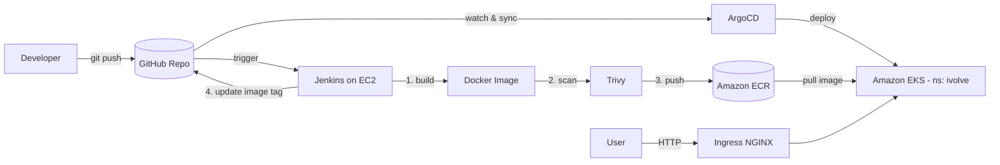

# CloudDevOpsProject

An end-to-end DevOps project that provisions AWS infrastructure with **Terraform**, configures a Jenkins server with **Ansible**, builds and scans container images with **Jenkins + Trivy**, stores them in **Amazon ECR**, and deploys the **iVolve** application to **Amazon EKS** using **ArgoCD** (GitOps).

> Application source: [IbrahimAdel15/iVolveFinalProject](https://github.com/IbrahimAdel15/iVolveFinalProject)

---

## Table of Contents
- [Architecture](#architecture)
- [Tech Stack](#tech-stack)
- [Repository Structure](#repository-structure)
- [Prerequisites](#prerequisites)
- [Setup Instructions](#setup-instructions)
- [CI/CD Flow](#cicd-flow)
- [Kubernetes Resources](#kubernetes-resources)
- [Cleanup](#cleanup)

---

## Architecture



**Network layout**

- 1 VPC (`10.0.0.0/16`)
- 2 public subnets (IGW) and 2 private subnets across 2 Availability Zones
- 1 NAT Gateway for private subnet egress
- Network ACL attached to all subnets
- Jenkins EC2 in a public subnet with a dedicated Security Group
- EKS managed node group: **2 worker nodes** in the 2 private subnets (different AZs)

---

## Tech Stack

| Area | Tool |
|---|---|
| Source control | GitHub |
| Containers | Docker, Docker Compose |
| Infrastructure as Code | Terraform (S3 remote backend) |
| Configuration management | Ansible (roles + dynamic inventory) |
| CI | Jenkins (Shared Library), Trivy |
| Registry | Amazon ECR |
| Orchestration | Kubernetes (Amazon EKS) |
| CD / GitOps | ArgoCD |

---

## Repository Structure

```
CloudDevOpsProject/
├── docker-compose.yml        # Run app + DB locally
├── iVolveFinalProject/       # Application source code
├── terraform/
│   ├── backend.tf            # S3 backend
│   ├── main.tf
│   └── modules/
│       ├── network/          # VPC, subnets, IGW, NAT, NACL
│       ├── server/           # Jenkins EC2 + Security Group
│       ├── eks/              # EKS cluster + 2 worker nodes
│       └── ecr/              # ECR repositories
├── ansible/
│   ├── ansible.cfg
│   ├── inventory/aws_ec2.yml # Dynamic inventory
│   ├── site.yml
│   └── roles/                # java, docker, trivy, jenkins
├── k8s/
│   ├── namespace.yaml
│   ├── storageclass.yaml
│   ├── configmap.yaml
│   ├── secret.yaml
│   ├── ingress.yaml
│   ├── database/             # StatefulSet + Headless Service
│   ├── backend/              # Deployment + Service
│   └── frontend/             # Deployment + Service
├── vars/                     # Jenkins Shared Library
├── jenkins/                  # Jenkinsfile per microservice
├── argocd/application.yaml   # ArgoCD Application
└── docs/                     # Architecture & setup docs
```

---

## Prerequisites

- AWS account + AWS CLI configured (`aws configure`)
- Terraform >= 1.5
- Ansible with `boto3` and `botocore`
- kubectl and Helm
- Docker and Docker Compose
- An existing EC2 key pair
- An S3 bucket for the Terraform state

---

## Setup Instructions

### 1. Run locally with Docker Compose
```bash
docker compose up --build
```

### 2. Provision infrastructure (Terraform)
```bash
# Create the state bucket once, then set its name in terraform/backend.tf
aws s3 mb s3://<your-tfstate-bucket>

cd terraform
terraform init
terraform plan -var key_name=<your-keypair>
terraform apply -var key_name=<your-keypair>
```
Outputs: Jenkins public IP, EKS cluster name, ECR repository URLs.

### 3. Configure Jenkins server (Ansible)
```bash
cd ansible
pip install boto3 botocore
ansible-galaxy collection install -r requirements.yml community.general
ansible-inventory --graph      # verify the dynamic inventory finds the Jenkins host
ansible-playbook site.yml
```
The playbook installs Java, Docker, Trivy, and Jenkins, then prints the Jenkins initial admin password.
Open `http://<jenkins-public-ip>:8080`.

### 4. Connect to EKS and install the Ingress controller
```bash
aws eks update-kubeconfig --name ivolve-eks --region us-east-1

helm upgrade --install ingress-nginx ingress-nginx \
  --repo https://kubernetes.github.io/ingress-nginx \
  --namespace ingress-nginx --create-namespace
```

### 5. Install ArgoCD and deploy the app
```bash
kubectl create namespace argocd
kubectl apply -n argocd -f https://raw.githubusercontent.com/argoproj/argo-cd/stable/manifests/install.yaml
kubectl apply -f argocd/application.yaml

# Initial admin password
kubectl -n argocd get secret argocd-initial-admin-secret \
  -o jsonpath='{.data.password}' | base64 -d
```

### 6. Configure Jenkins
1. Install plugins: Git, Pipeline, Credentials Binding.
2. **Manage Jenkins → System → Global Trusted Pipeline Libraries**
   - Name: `ivolve-shared-lib`
   - Source: this repository (the `vars/` folder at the root)
3. Add credentials `github-creds` (GitHub username + personal access token).
4. Attach an IAM role with ECR push permissions to the Jenkins EC2 instance.
5. Create one Pipeline job per microservice using:
   - `jenkins/Jenkinsfile.frontend`
   - `jenkins/Jenkinsfile.backend`

### 7. Access the application
```bash
kubectl get ingress -n ivolve
```
Open the load balancer hostname in your browser.

> Before running, replace every `REPLACE_*` placeholder (AWS account ID, GitHub username, S3 bucket, key pair name) and make sure service names and ports match the application source.

---

## CI/CD Flow

Each microservice has its own Jenkins pipeline built on a shared library (`vars/`):

| # | Stage | What it does |
|---|---|---|
| 1 | Build Image | `docker build` the service image |
| 2 | Scan Image | Trivy scan for HIGH/CRITICAL vulnerabilities |
| 3 | Push Image | Authenticate to ECR and push the image |
| 4 | Delete Image Locally | Remove the local image to free disk space |
| 5 | Update Manifests | Update the image tag in `k8s/<service>/deployment.yaml` |
| 6 | Push Manifests | Commit and push the updated manifest to GitHub |

ArgoCD watches the `k8s/` path and automatically syncs changes into the `ivolve` namespace (auto-sync, prune, self-heal enabled).

---

## Kubernetes Resources

| Resource | Purpose |
|---|---|
| Namespace `ivolve` | Isolates the application |
| Deployment + Service (frontend, backend) | Stateless microservices |
| StatefulSet `mysql` | Database with persistent storage |
| Headless Service `mysql-headless` | Stable network identity for the StatefulSet |
| StorageClass `ivolve-gp3` | EBS gp3 volumes via the EBS CSI driver |
| ConfigMap / Secret | Environment variables and credentials |
| Ingress | Exposes the frontend through NGINX |

> The included Secret holds demo values only. Use Sealed Secrets or External Secrets for real environments.

---

## Cleanup

EKS and the NAT Gateway are billed hourly, so destroy everything when you are done:

```bash
cd terraform
terraform destroy -var key_name=<your-keypair>
```

---

## Author

**Your Name** — [GitHub](https://github.com/REPLACE_USER)
OpsProject
